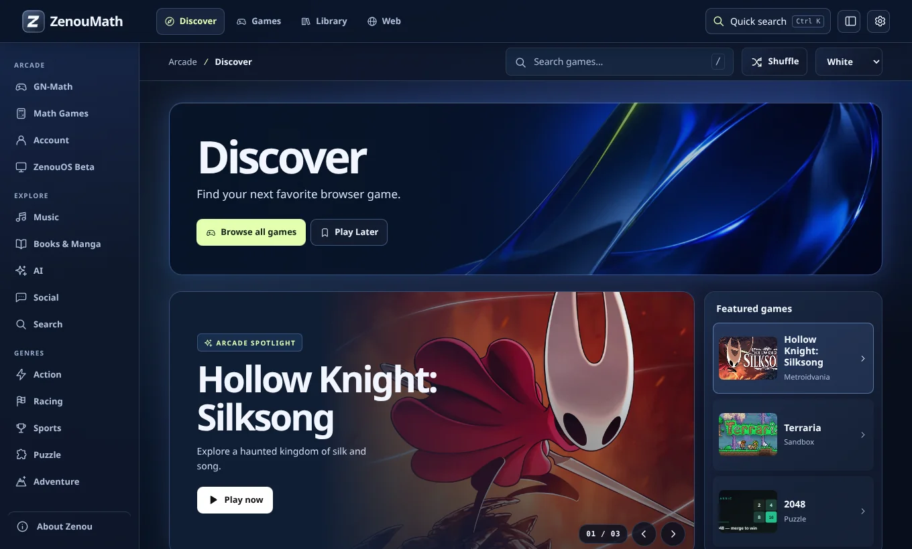
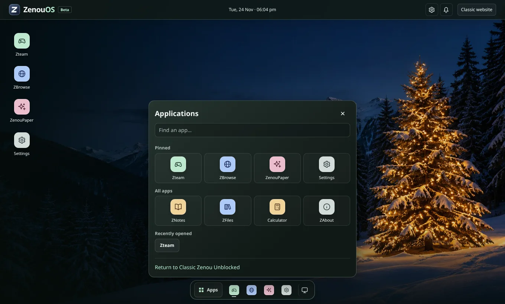

<div align="center">


# ZenouMath

**A browser arcade with a desktop of its own.**

Browse games by genre, shuffle the catalogue when you can't pick, or save a title for later. Switch to the optional ZenouOS desktop to open your games and tools in their own windows.

[](https://zenoumath.space/)
[](package.json)
[](LICENSE)

[**Open the arcade**](https://zenoumath.space/) · [Try ZenouOS Beta](https://zenoumath.space/os/) · [Explore](#explore) · [Run locally](#run-locally)

</div>

| Arcade · Discover | ZenouOS Beta · App launcher |
| :---: | :---: |
| [](docs/screenshots/arcade.webp) | [](docs/screenshots/zenouos.webp) |

## Explore

| Where to go | What you can do |
| --- | --- |
| [**All games**](https://zenoumath.space/?all=1) | Search for a title, browse a genre or use **Shuffle** to pick your next game. |
| [**My library**](https://zenoumath.space/library/) | Reopen recently played games, keep a **Play Later** queue, and organise favourites, playlists, ratings and notes. An optional username account syncs favourites, ratings and notes across browsers. |
| [**ZenouOS Beta**](https://zenoumath.space/os/) | Launch games from **Zteam**, change the wallpaper in **ZenouPaper Engine**, or keep **ZNotes** open alongside another app. Choose **Classic website** to switch back. |
| **Media** | Browse [books and manga](https://zenoumath.space/books/), open the [music player](https://zenoumath.space/music/), or look up [films and TV shows](https://zenoumath.space/movies/). Playback depends on the external provider. |
| **Tools** | Open the [web tools](https://zenoumath.space/web/) or explore the [AI assistant and tool directory](https://zenoumath.space/ai/). |

## Run locally

The arcade is built with HTML, CSS and JavaScript. The included Node.js server serves the site and its media API. Use **Node.js 20 or newer**.

```bash
git clone https://github.com/zenou101/zenoumath.git
cd zenoumath
npm start
```

Open **http://127.0.0.1:8123**. You can browse the arcade and launch ZenouOS without an API key. For live TMDB movie and TV metadata, copy [.env.example](.env.example) to `.env`, set `TMDB_READ_TOKEN` or `TMDB_API_KEY`, and restart the server.

### Development

| Command | Purpose |
| --- | --- |
| `npm run dev` | Start the local server and restart it when server code changes. |
| `npm test` | Exercise the media API against local test data. |
| `node scripts/audit.mjs` | Check internal links and sitemap routes while the local server is running. |

### Project layout

| Path | Contents |
| --- | --- |
| [`arcade.js`](arcade.js) and [`catalog/`](catalog/) | Discover page behaviour and the catalogues used across the site |
| [`os/`](os/) | ZenouOS desktop, window manager, Zteam and wallpaper gallery |
| [`js/`](js/) and [`css/`](css/) | Shared browser features, account sync and styles |
| [`server/`](server/) and [`scripts/`](scripts/) | Local HTTP server, media API and project checks |

## Copyright and usage

**© 2026 ZenouMath / zenou101. All rights reserved.** The original code and assets are published for viewing and reference. Reuse, modification and redistribution require prior written permission, subject to applicable law and GitHub's Terms of Service. Third-party games, embeds, logos and trademarks retain their respective owners' rights. See the [licence](LICENSE).

ZenouMath is independent of schools and education authorities. [Site terms and privacy](https://zenoumath.space/legal/) · [Report an issue](https://github.com/zenou101/zenoumath/issues).
